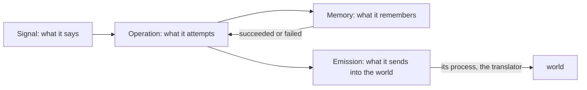
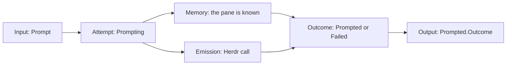
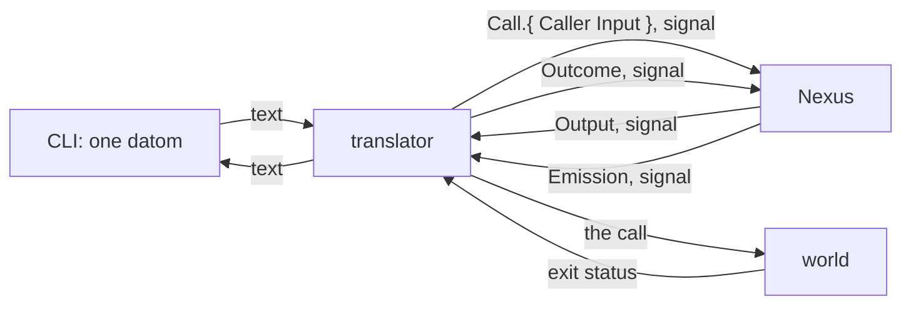
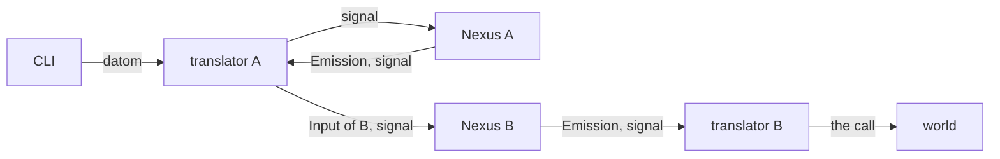

# A Nexus

Version 1. Nexus is an architecture; a component built in it has four parts, each its own ethos. The translator is the process of the fourth, Emission.



## An operation is an attempt

A signal in is an attempt at something; the attempt is the operation. Operation declares one attempt per input, named as the doing, and the outcome each attempt ends in; Signal's output is made from that outcome.



## The translator

The Nexus decodes signal and nothing else. The translator is the process in front of it that speaks text: a datom typed at the CLI comes in through it, and every emission goes out through it.



```ethos
Library
[ signal:[ Input Output Caller Error ]
  std:[ Connection ] ]
[ Translator.{ NexusSocket.String }   ; the socket of the Nexus it speaks for
  Call.{ Caller Input }               ; what the translator sends in
  Outcome.[ Answered                  ; one reply written back
            Unreadable.Error          ; the text was not an Input
            NexusDown ] ]
[ Serving.[ serve.{ [ Connection ] [ Outcome ] } ] ]
[ Translator.[ Serving ] ]
```

## A command line is a type

What a Nexus sends into the world is a typed value: a variant per subcommand, a field per argument, a String only where a user writes freely. The translator turns the value into the call; it is the one place that holds the words.

```ethos
Emission
[]
[ Command.{ Verb Vector<Argument> } ]  ; emissions
[ Outcome.[ Done Refused.Integer ] ]   ; outcomes
[ Verb.[ List Show ]                   ; types
  Argument.[ Name.String Quiet ] ]
[ Arguable.[ argv.[ Vector<String> ] ] ]
[ Verb.[ Arguable ]
  Argument.[ Arguable ]
  Command.[ Arguable ] ]
```

```rust
impl Arguable for Verb {
    fn argv(&self) -> Vec<String> {
        match self {
            Verb::List => vec!["list".into()],
            Verb::Show => vec!["show".into()],
        }
    }
}
impl Arguable for Argument {
    fn argv(&self) -> Vec<String> {
        match self {
            Argument::Name(s) => vec![s.clone()],
            Argument::Quiet => vec!["--quiet".into()],
        }
    }
}
impl Arguable for Command {
    fn argv(&self) -> Vec<String> {
        let mut v = self.verb.argv();
        for a in &self.argument_vector { v.extend(a.argv()) }
        v
    }
}
impl Emittable for Command {           // trait: generated
    type Outcome = Outcome;
    fn emit(&self, t: &Translator) -> Outcome {
        t.call(&self.argv())
    }
}
```

## A meta surface sets one value at a time

A Nexus's meta surface sets one value at a time, and a subscription sees the configuration as it changes.

## Two Nexuses



Signal between Nexuses, never text. A Nexus admits signal from the peers its meta configuration names: a typed peer list, each peer bound by kernel credentials as its own translator is; ownership stays per caller.
