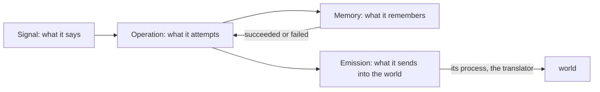
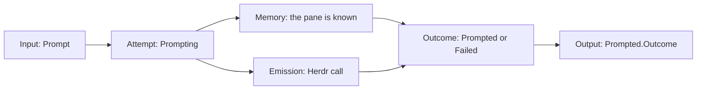
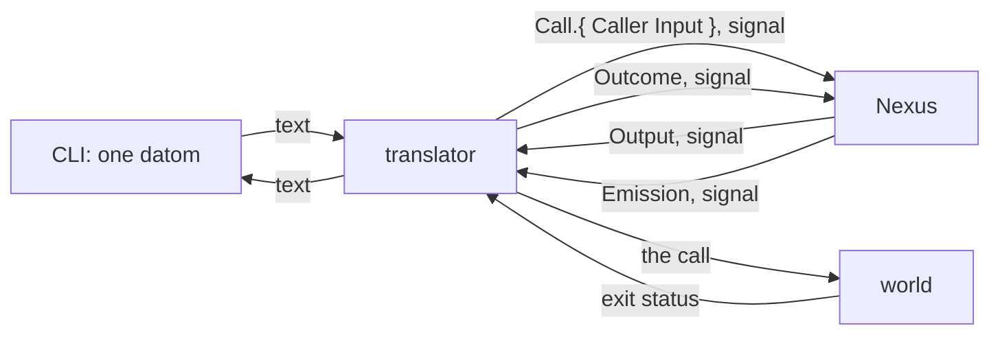
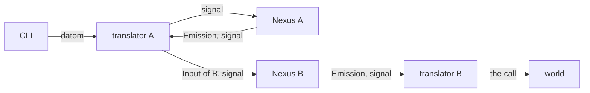

# A Nexus

Nexus is an architecture; a component built in it has four parts, each its own ethos. The translator is the process of the fourth, Emission.



## An operation is an attempt

A signal in is an attempt at something; the attempt is the operation. Operation declares each attempt named as the doing, and the outcome each attempt ends in; Signal's output is made from that outcome. One attempt per input; an attempt may compose several typed emissions, each emission one external call.



## The translator

The Nexus decodes signal and nothing else. The translator is the process in front of it that speaks text: a datom typed at the CLI comes in through it, and every emission goes out through it. Every translator carries the Caller, from the connection's peer credentials, in `Call.{ Caller Input }`.



The following conceptual Ethos names composed single-reply observations at the connection boundary. Each translator declares its executable capability and how request preparation and fallible execution produce those observations. The Belief ordinary single-reply contract separates preparation from checked execution and retains native failure evidence in process.

```ethos
Library
[ signal:[ Input Output Error ]
  std:[ Connection ] ]
[ Translator.{ NexusSocket.String }   ; the socket of the Nexus it speaks for
  Caller.{ ProcessId.Integer          ; the connection's
           UserId.Integer }           ;   peer credentials
  Call.{ Caller Input }               ; what the translator sends in
  Outcome.[ Answered                  ; one reply written back
            Unreadable.Error          ; the text was not an Input
            NexusDown ] ]
[ Serving.[ serve.{ [ Connection ] [ Outcome ] } ] ]
[ Translator.[ Serving ] ]
```

## A command line is a type

What a Nexus sends into the world is a typed value: a variant per subcommand, a field per argument, a String only where a user writes freely. The translator turns the value into the call; it is the one place that holds the words.

```ethos
Emission
[]
[ Command.{ Verb Vector<Argument> } ]  ; emissions
[ Outcome.[ Done Refused.Integer ] ]   ; outcomes
[ Verb.[ List Show ]                   ; types
  Argument.[ Name.String Quiet ] ]
[ Arguable.[ argv.[ Vector<String> ] ] ]
[ Verb.[ Arguable ]
  Argument.[ Arguable ]
  Command.[ Arguable ] ]
```

```rust
impl Arguable for Verb {
    fn argv(&self) -> Vec<String> {
        match self {
            Verb::List => vec!["list".into()],
            Verb::Show => vec!["show".into()],
        }
    }
}
impl Arguable for Argument {
    fn argv(&self) -> Vec<String> {
        match self {
            Argument::Name(s) => vec![s.clone()],
            Argument::Quiet => vec!["--quiet".into()],
        }
    }
}
impl Arguable for Command {
    fn argv(&self) -> Vec<String> {
        let mut v = self.verb.argv();
        for a in &self.argument_vector { v.extend(a.argv()) }
        v
    }
}
impl Emittable for Command {           // trait: generated
    type Outcome = Outcome;
    fn emit(&self, t: &Translator) -> Outcome {
        t.call(&self.argv())
    }
}
```

## A Nexus starts in its place

A Nexus reads nothing from the environment: it is started with one datom, its place. Runtime holds its sockets and defaults to `$XDG_RUNTIME_DIR/nexus/<place-name>/`; State holds its memory and defaults to `$XDG_STATE_HOME/nexus/<place-name>/`, `~/.local/state/nexus/<place-name>/` when the variable is unset. Both roots are the CLI's fixed defaults, taken from the standard XDG variables and from nothing else, never an argument. The CLI is `<nexus-name> '<datom>'`: named after the Nexus, and taking the datom and nothing else. Whatever else it knows is its configuration, one datom at `$XDG_CONFIG_HOME/nexus/<nexus-name>.datom`, the place first among its values and more as the CLI gains options. The place name is resolved under the runtime root to the sockets. Two places are two names, and the stable one keeps running while the next is tried; a place is reached by the configuration that names it, so the testing capsule has its own configuration as it has its own sockets and store, and no place is ever typed.

```ethos
Library
[]
[ PlaceName.String                   ; main, next
  Place.{ PlaceName                  ; what every Nexus starts with
          Runtime.String             ; the sockets
          State.String }             ; the memory
  CliConfiguration.{ PlaceName } ]   ; what the CLI knows besides its datom; grows as the CLI gains options
[]
[]
```

```sh
# ~/.config/nexus/flow-nexus.datom
{ main }
flow-nexus 'Launch.{ designer fable «Read the book» }'
```

```datom
; a Nexus, started by the shell
{ main /run/user/1001/nexus/main
  /home/li/.local/state/nexus/main }
; the sockets it makes there
; <nexus>.sock  <nexus>-meta.sock  <nexus>-translator.sock  <nexus>-meta-translator.sock
; the meta CLI's text arrives at <nexus>-meta-translator.sock and becomes signal for <nexus>-meta.sock; the ordinary translator refuses meta text
; flow.sock  flow-meta.sock  flow-translator.sock  flow-meta-translator.sock
```

## A meta surface sets one value at a time

A Nexus's meta surface sets one value at a time, and a subscription sees the configuration as it changes.

## Two Nexuses



Signal between Nexuses, never text. A Nexus admits signal from the peers its meta configuration names: a typed peer list, each peer bound by kernel credentials as its own translator is; ownership stays per caller.
