# A Nexus

Nexus is an architecture; a component built in it has four parts, each its own ethos. The translator is the program of the fourth, Emission.

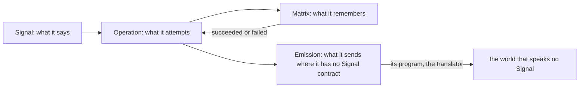

The translator is a program of its own, beside the Nexus: the Nexus's program holds no text code at all, which is what a translator is for. A Nexus speaks Signal without its translator; the translator lets a program, or a part of the system, that does not speak Signal understand what the Nexus says, and speak to it.

## An operation is an attempt

A signal in is an attempt at something; the attempt is the operation. Operation declares each attempt named as the doing, and the outcome each attempt ends in; Signal's output is made from that outcome. One attempt per input; an attempt may compose several typed emissions, each emission one call to what speaks no Signal.

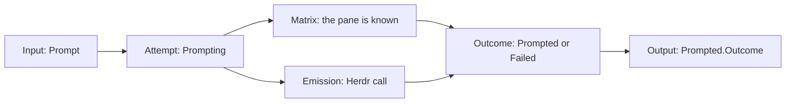

## The translator

The translator talks for its Nexus, and for that Nexus alone, to the part of the world the Nexus has no Signal contract with: whatever speaks no Signal. The Nexus's logic holds typed values and no string; the translator is the one place that holds the words. The caller comes through it too: a datom typed at the CLI is read by the translator into an input, and the output is written back by it as a datom. Every input the translator hands in carries the Caller, from the connection's peer credentials, in `Call.{ Caller Input }`.

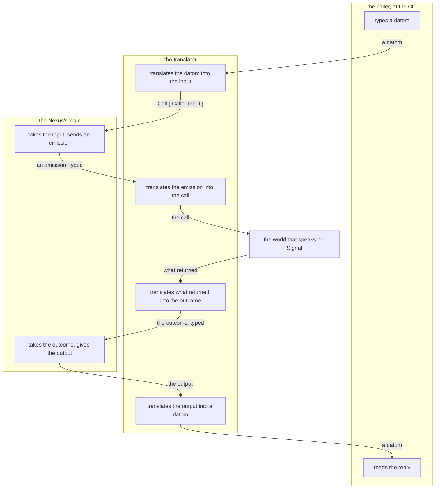

```ethos
Library
[ signal:[ Input Output Error ]
  std:[ Connection ] ]
[ Translator.{ NexusSocket.String }
  Caller.{ ProcessId.Integer
           UserId.Integer }
  Call.{ Caller Input }
  Served.[ Answered
           Unreadable.Error
           NexusDown ] ]
[ Serving.[ serve.{ [ Connection ] [ Served ] } ] ]
[ Translator.[ Serving ] ]
```

A Translator holds the socket of the Nexus it speaks for; a Caller is the connection's peer credentials, and a Call is what the translator sends in. A text connection is Served as Answered, one reply written back, Unreadable, the text was not an Input, or NexusDown. The word outcome is kept for what returns from an emission.

## What leaves a Nexus

A Nexus deals in no string: that rule stands above every other here. Logic stays in a Nexus, and that rule yields to the first: turning a typed value into a system call, and reading what it returned, takes some logic, and that logic is the translator's, as a form of translation.

What leaves a Nexus goes to another Nexus, as Signal, or to a translator. What must be done outside any Nexus is reached through a translator.

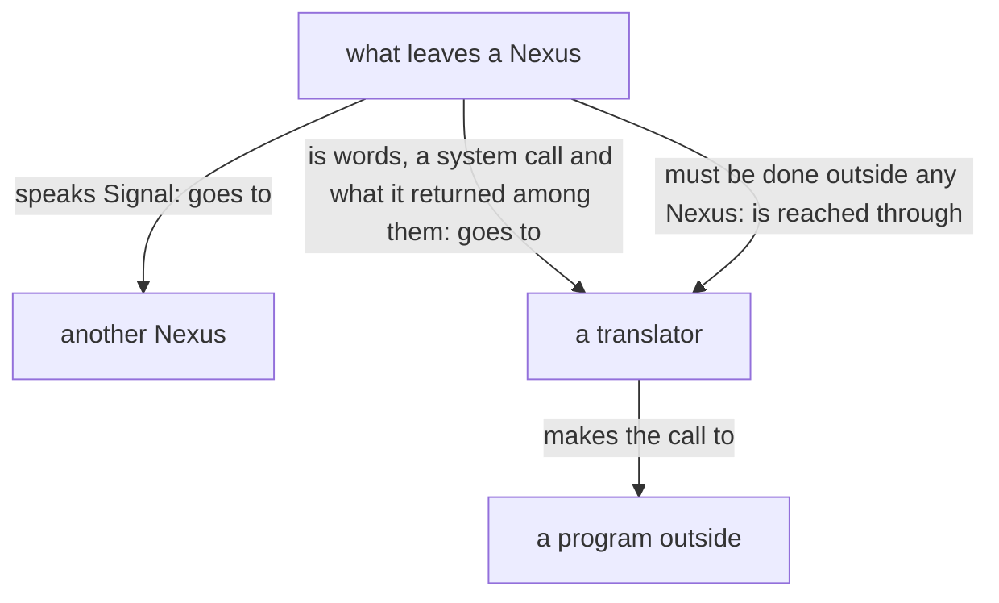

## An emission

An emission is a typed value a Nexus sends out to something other than the caller it is answering: the emissions are the types a Nexus has for speaking to the part of the world it has no Signal contract with. The translator makes a translation of the emission, a datom written into a file, a system call or a request to a service, and what returned comes back as the emission's typed outcome, which tells the Nexus in its own terms what happened.

Whatever wants to talk to a Nexus speaks Datom to its translator, which translates it into an input. That is the one way in for all that does not speak Signal.

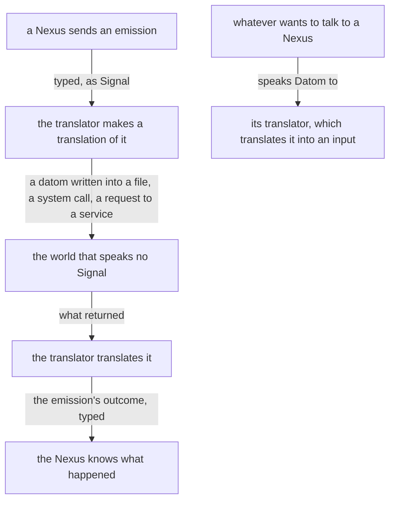

## Every exchange is one connection

A datom and its reply, a Call and its Output, an emission and its outcome: each is one connection, dialed by the side that begins it. The connection alone pairs what was sent with what came back.

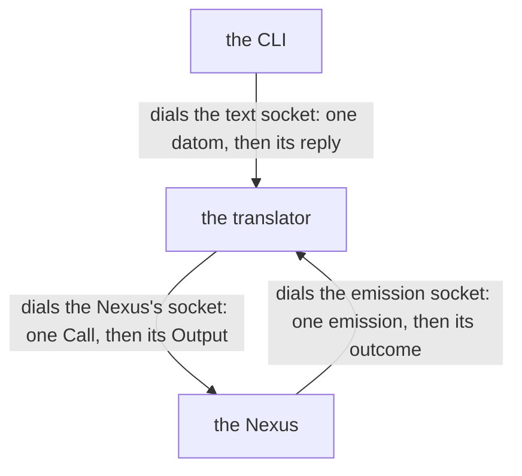

An emission that finds its translator ends in its own outcome. One that does not is Unobserved, and the two cases are kept apart, since after the second the call may have been made.

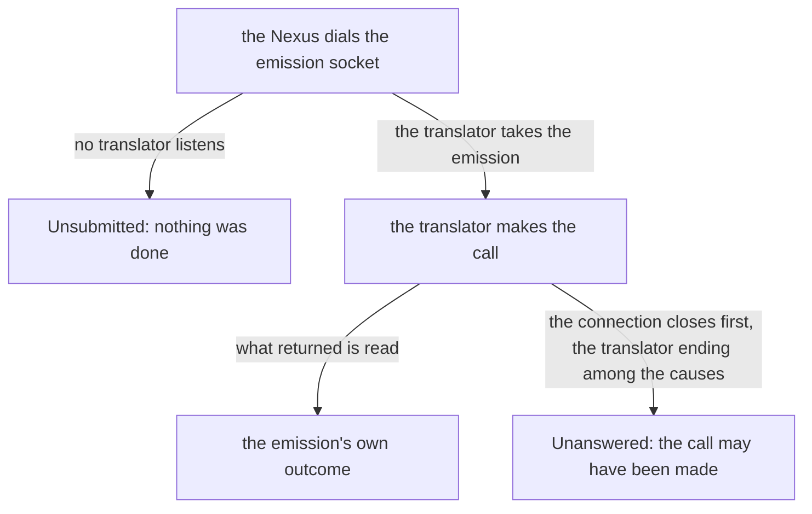

```ethos sketch
Library
[ std:[ Emittable ] ]
[ EmissionSocket.String
  Unobserved.[ Unsubmitted Unanswered ] ]
[ Sending.[ send.{ [ Emittable ] [ Result<Outcome Unobserved> ] } ] ]
[ EmissionSocket.[ Sending ] ]
```

An EmissionSocket is the translator's emission socket as the Nexus holds it, from its place. Sending is written once, for every Nexus; the Outcome it yields is the outcome of the emission it was given.

```rust
match emission_socket.send(Resolve { git, repository, reference }) {
    Ok(Resolution::Resolved(revision)) => { /* the Nexus's own logic */ }
    Ok(Resolution::Unresolved(status)) => { /* … */ }
    Err(Unobserved::Unsubmitted) => { /* nothing was done */ }
    Err(Unobserved::Unanswered) => { /* the call may have been made */ }
}
```

## The translator keeps nothing

What a call needs that a person sets, the path of a program, the address of a service, the name of a credential, is a value the meta surface sets in the Nexus's Matrix, and it reaches the translator inside the emission. The translator holds the words of the call and no value of its own, so it is started, ended and started again without anything being told to it.

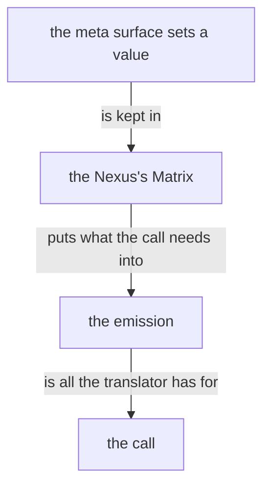

## A command line is a type

What a Nexus sends where it has no Signal contract is a typed value: a variant per subcommand, a field per argument, a String only where a user writes freely. The translator turns the value into the call; it is the one place that holds the words.

```ethos sketch
Emission
[]
[ Command.{ Program Verb Vector<Argument> } ]
[ Outcome.[ Done Refused.Integer ] ]
[ Program.String
  Verb.[ List Show ]
  Argument.[ Name.String Quiet ] ]
[ Arguable.[ argv.[ Vector<String> ] ] ]
[ Verb.[ Arguable ]
  Argument.[ Arguable ]
  Command.[ Arguable ] ]
```

The emission below is written as the trace writes it; the path is plainly an example.

```datom
Command.{ «/example/bin/tool» Show [ Name.«notes» Quiet ] }
```

```rust
impl Arguable for Verb {
    fn argv(&self) -> Vec<String> {
        match self {
            Verb::List => vec!["list".into()],
            Verb::Show => vec!["show".into()],
        }
    }
}
impl Arguable for Argument {
    fn argv(&self) -> Vec<String> {
        match self {
            Argument::Name(s) => vec![s.clone()],
            Argument::Quiet => vec!["--quiet".into()],
        }
    }
}
impl Arguable for Command {
    fn argv(&self) -> Vec<String> {
        let mut v = vec![self.program.0.clone()];
        v.extend(self.verb.argv());
        for a in &self.argument_vector { v.extend(a.argv()) }
        v
    }
}
impl Emittable for Command {
    type Outcome = Outcome;
    fn emit(&self) -> Outcome {
        match run(&self.argv()) {
            0 => Outcome::Done,
            status => Outcome::Refused(status),
        }
    }
}
```

The running of a program, run, is the translator library's, written once; the body gives it the words and reads what returned into the outcome.

## What a translator is made of

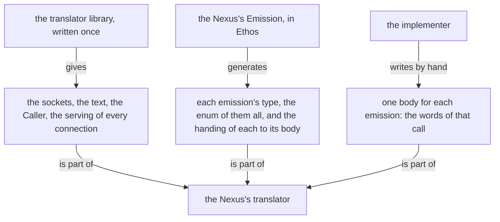

The Ethos, from the Source Nexus:

```ethos sketch
Emission
[ source:[ Git Nix Repository Reference Revision ] ]
[ Resolve.{ Git Repository Reference }
  Fetch.{ Nix Repository Revision } ]
[ Resolution.[ Resolved.Revision
               Unresolved.Integer ]
  Fetching.[ Fetched
             Unfetched.Integer ] ]
[]
```

The Rust generated from it, in the namespace the root implies:

```rust
pub mod emission {
    pub enum Emission { Resolve(Resolve), Fetch(Fetch) }
    pub enum Outcome { Resolution(Resolution), Fetching(Fetching) }
}
impl Emittable for emission::Emission {
    type Outcome = emission::Outcome;
    fn emit(&self) -> emission::Outcome {
        match self {
            emission::Emission::Resolve(resolve) => emission::Outcome::Resolution(resolve.emit()),
            emission::Emission::Fetch(fetch) => emission::Outcome::Fetching(fetch.emit()),
        }
    }
}
```

The Rust written by hand, the whole of the Source Nexus's translator:

```rust
impl Emittable for Resolve {
    type Outcome = Resolution;
    fn emit(&self) -> Resolution { self.git.remote_revision(&self.repository, &self.reference) }
}
impl Emittable for Fetch {
    type Outcome = Fetching;
    fn emit(&self) -> Fetching { self.nix.fetch(&self.repository, &self.revision) }
}
```

Git and Nix are each the path of a program: a value the meta surface set, carried in the emission.

## A Nexus starts in its place

A Nexus reads nothing from the environment: it is started with one datom, its place. Runtime holds its sockets and defaults to `$XDG_RUNTIME_DIR/nexus/<place-name>/`; State holds its Matrix and defaults to `$XDG_STATE_HOME/nexus/<place-name>/`, `~/.local/state/nexus/<place-name>/` when the variable is unset. Both roots are the CLI's fixed defaults, taken from the standard XDG variables and from nothing else, never an argument. The CLI is `<component> '<datom>'`: named after the component, without the nexus suffix, and taking the datom and nothing else. Whatever else it knows is its configuration, one datom at `$XDG_CONFIG_HOME/nexus/<nexus-name>.datom`, the place first among its values and more as the CLI gains options. The place name is resolved under the runtime root to the sockets. Two places are two names, and the stable one keeps running while the next is tried; a place is reached by the configuration that names it, so the testing capsule has its own configuration as it has its own sockets and store, and no place is ever typed.

```ethos
Library
[]
[ PlaceName.String
  Place.{ PlaceName
          Runtime.String
          State.String }
  CliConfiguration.{ PlaceName } ]
[]
[]
```

A PlaceName is main or next; a Place is what every Nexus starts with, Runtime the sockets and State the Matrix; and CliConfiguration is what the CLI knows besides its datom, which grows as the CLI gains options.

The first line below is the content of ~/.config/nexus/flow-nexus.datom, and the second is a call of the CLI.

```sh
{ main }
flow 'Launch.{ designer fable «Read the book» }'
```

A place, as an example; its user and its home are plainly examples.

```datom
{ main /run/user/1000/nexus/main
  /home/example/.local/state/nexus/main }
```

A Nexus is started by the shell with its place, as above, and makes its two sockets, <nexus>.sock and <nexus>-meta.sock. Its translator is started with the same place and makes its three: <nexus>-translator.sock and <nexus>-meta-translator.sock, which take text, and <nexus>-emission.sock, which takes its Nexus's emissions. Each starts without the other. The meta CLI's text arrives at <nexus>-meta-translator.sock and becomes signal for <nexus>-meta.sock, and the ordinary text socket refuses meta text. For the Flow Nexus these are flow.sock, flow-meta.sock, flow-translator.sock, flow-meta-translator.sock and flow-emission.sock.

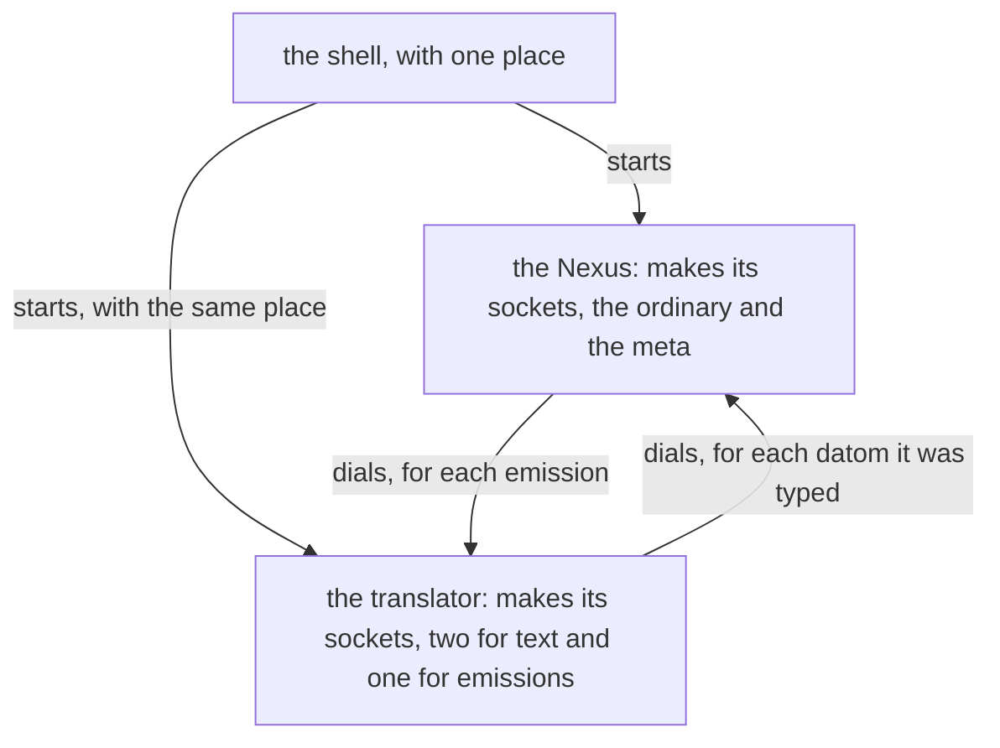

## The CLI

The CLI holds no type of its Nexus: reading the datom is the translator's. So the CLI is written once, in the client library, for every Nexus, and what a Nexus adds is its name. Its two CLIs, the ordinary and the meta, are generated with it, each one call of the library.

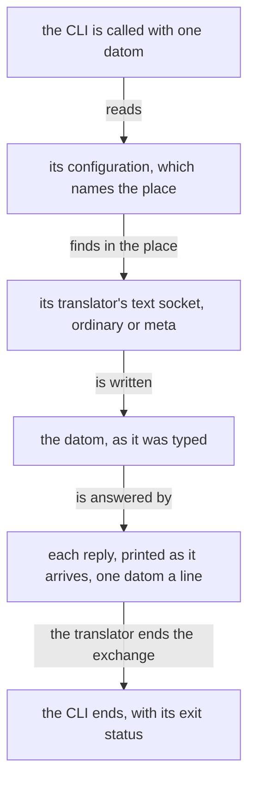

```ethos sketch
Library
[]
[ TextSocket.[ Ordinary Meta ]
  Path.String
  Reason.String
  Unsent.[ Usage
           Missing.Path
           Unreadable.{ Path Reason }
           Invalid.{ Path Reason } ]
  Ending.[ Answered Failed Unsent ] ]
[ Named.[ name:[ String ] ]
  Calling.{ [ Named ]
            []
            []
            [ call:{ [ TextSocket ] [ Ending ] } ] } ]
[]
```

Named is what a Nexus adds, its name; Calling is the whole CLI, its body the library's. An Ending is the exit status: Answered is 0, a reply was printed, a refusal the Nexus typed among them; Failed is 1, the translator could not answer; Unsent is 2, nothing was sent, and the refusal names the file.

The Rust generated for the Flow Nexus, its two CLIs whole:

```rust
fn main() -> ExitCode { Flow::call(TextSocket::Ordinary).into() }
fn main() -> ExitCode { Flow::call(TextSocket::Meta).into() }
```

```sh
flow 'Queues'
energy 'Subscribe'
flow
```

The first prints one reply and ends. The second is a reply that lasts: each datom is printed as it arrives, until the caller ends it. The third, called with no datom, prints the Ethos of the Input and the Output, which the CLI asks of the translator.

## A meta surface sets one value at a time

A Nexus's meta surface sets one value at a time, and a subscription sees the configuration as it changes.

## Two Nexuses

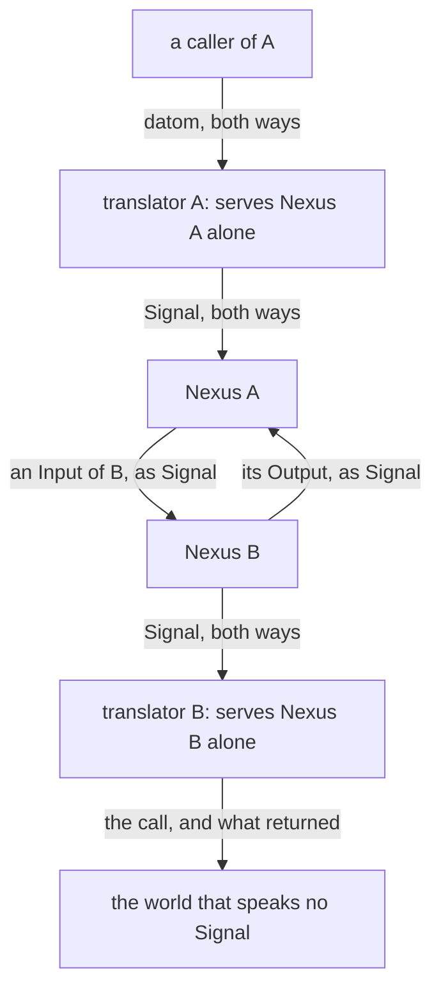

Signal between Nexuses, never text. A Nexus admits signal from the peers its meta configuration names: a typed peer list, each peer bound by kernel credentials as its own translator is; ownership stays per caller.

## The trace

What a Nexus traces is Signal, declared in an ethos. The trace goes one of two ways, by a configured mode. Translated, a debugging translator writes it out as datom while the Nexus runs. Archived, the Nexus stores the Signal as it is, in an archive in its Matrix, and no translator runs: the archive's file name gives the version of the Nexus that wrote it, which says the translator that reads it later. Many nodes under test each keep an archive, and a translator is started only for the one that is read.

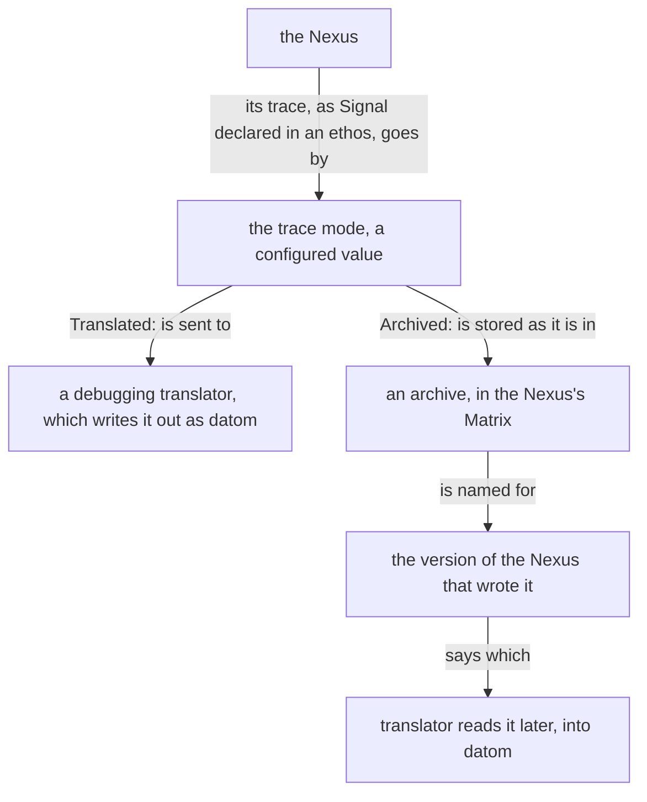

```ethos sketch
Types
[ TraceMode.[ Translated Archived ] ]
```

An archive's file name, as an example; the version is plainly an example.

```sh
flow-trace-1.4.0.signal
```
