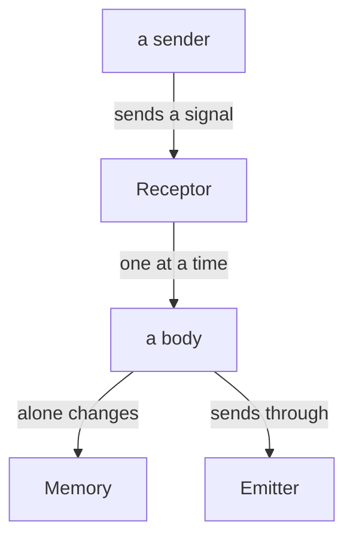
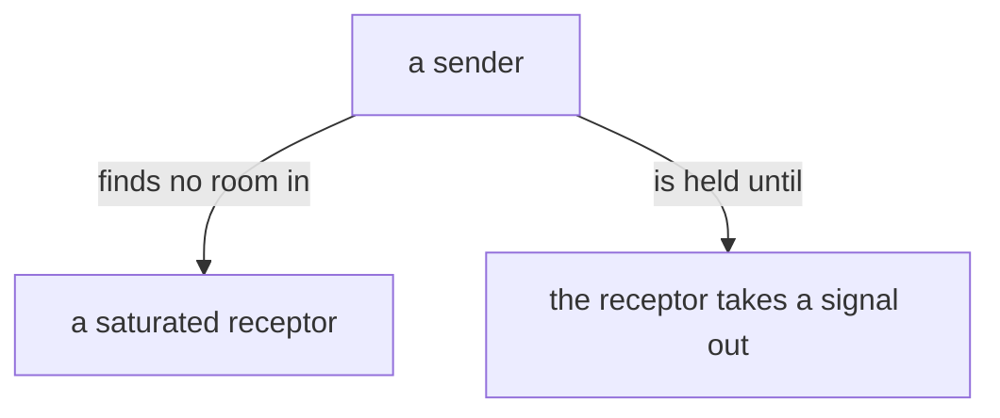

| organ | is |
|---|---|
| Receptor | receives signals, and answers them |
| Emitter | sends what nobody asked for |
| Memory | what the organism holds |

A meta-organism is an organism whose organs are organisms.
## The organism file

```ethos
Signal
[]
[ Lock.LockName
  Release.LockId ]
[ Locked.LockId
  Released.Lock
  Unknown.LockId ]
[ LockId.Integer
  LockName.String
  Lock.{ LockId LockName } ]
```

```ethos sketch
Matrix
[ :lock:[ LockId Lock ] ]
[ Locks.{ ⟦Lock⟧ LockId } ]
```

```ethos sketch
Organism
[ :lock:signal:[ Input Output ]
  :lock:[ Locks ] ]
[ Input Output ]
[]
[ Locks ]
[]
```

| position | holds |
|---|---|
| 1 | imports |
| 2 | the receptor: what it takes, then what it answers |
| 3 | the emitter: here nothing |
| 4 | the memory |
| 5 | the organs: here none |
## Held and saturated



| term | is |
|---|---|
| Saturated | a receptor with no room left |
| Held | a sender whose signal has no room |
