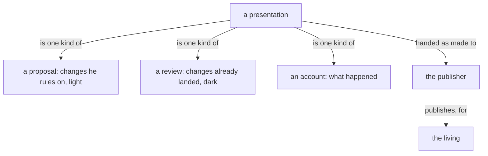

## A presentation

A presentation's source opens with its title and is handed to the publisher as made.

## A presentation is signed

A presentation names the model that created it and, for each model that helped, what that help was, on a subtitle line under the title.

## Figures

A figure shows one thing, where the idea has a shape, and its colours and marks mean the same in every presentation.

A large amount of data reaches the living as a figure, drawn so that he grasps its size, its depth and its several dimensions at a glance. The words beside it carry only what the figure cannot.

Every flowchart, in a presentation or in a belief module, is Mermaid, in the figure grammar; a presentation shows the SVG drawn from it.

A figure shows how a thing moves, one question per figure, readable in seconds. Its grammar: a box is a thing or a collection; an arrow is a one-way relation carrying a verb, so that box, verb, box reads as a sentence; nearness and enclosure are kinship; top to bottom is order; colour carries a role or is absent. A figure is boxes joined by verbed arrows, drawn so a phone shows it. A sizable presentation carries several figures.

## Prose and code

Prose is shown as rendered text.

Code is shown as code, labelled with its language and highlighted in that language's colours.

Prose carries no code: a type, a value or a datom, however short, is a code block, and prose names a thing by its name alone.

## Change marks

A presentation shows belief modules, each under its repo › path; its headings, naming the module and the kind of change, are the only words it has of its own.

Colour is the sign of a change and lies in the margin alone: text keeps the page's colour, and code its language's colours, highlighted.

A line added shows a green margin. A line removed shows a red margin. A line moved between modules shows once, under a margin of a third colour, headed by the module it leaves and the module it enters.

A proposed change shows the light shade of its colour; a landed change shows the dark shade: darker is more.

