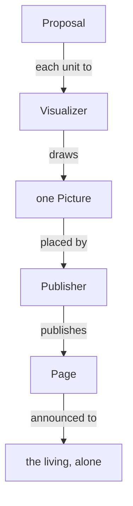

```ethos sketch
Types
[ Page.{ Title
         Signature
         Vector<Section> }
  Section.{ ModulePath
            Vector<Shown> }
  Shown.{ Picture
          Source
          Margin }
  Margin.[ Added Removed Replaced Standing ]
  Shade.[ Proposed Landed ] ]
```



```datom
[ { Added «green margin» }
  { Removed «red margin» }
  { Replaced «red beside green» }
  { Standing «no margin» }
  { Proposed «light shade» }
  { Landed «dark shade» } ]
```

```datom
[ { Statement «one to three, in the picture, largest» }
  { Title «none above a picture» }
  { Arrow «three words at most» }
  { Source «below its picture» }
  { Once «nothing is read twice» }
  { Signed «names the model that made it» }
  { Text «a block of text is never shown to him» } ]
```
