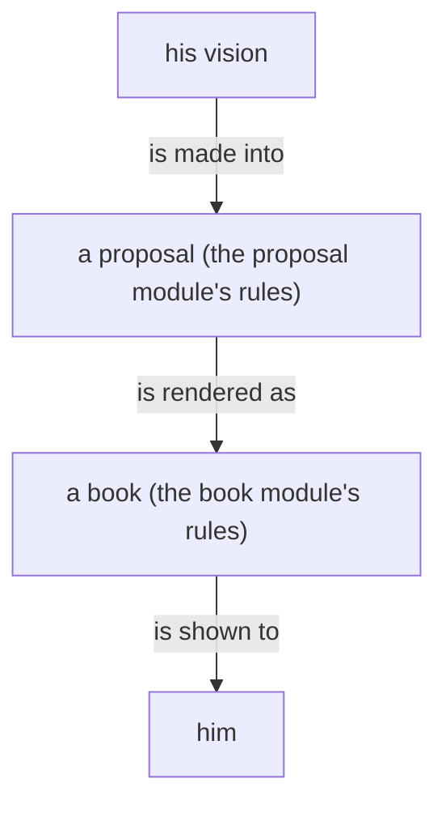
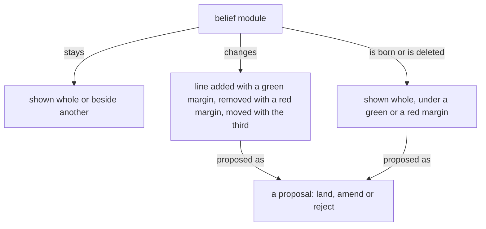

## A proposal

A proposal is a presentation: the prose and the code that describe the system as it will be, shown as changes to belief modules, in the light shades, for the living to rule on.

A proposal lives in its source file and is edited on his comments.

A proposal states what is wanted of the system; it documents nothing.

A proposal is the vision as it will be. A removed line is shown as the text it was, under a red margin, so the edit can be seen, and nothing else is made of it: it is not drawn, not summarised and not shown as a state of anything. A proof, a test, a milestone or a sequence of work is an order, and goes to a bead; written into a proposal it is a vision impurity.

A versioned module is self-contained: everything true of that version is in it, and the version is named once, in its description. Another version is not mentioned.

A proposal is a proposal into belief modules, and the whole of it is its crystallization: what it removes and what it adds.

A proposal has one subject, and small changes that belong together are one subject: one proposal per subject he would judge as one.

A proposal that touches a code component shows the code it changes or adds.

A code block in a proposal stands on its own. It carries the code, why it is important, and what its function is.

A proposal is usually drawn as well as written, and always when it has a shape; a figure draws what is wanted, and nothing of what goes. A flowchart in a proposal is a proposed line like any other: it stands under the addition margin of the proposal it belongs to, which names the module it goes to.

The proposal is the center of development: it is the evolution of an idea.

A line removed from a module is shown beside the line that makes it unnecessary.

A question between alternative lines shows each alternative as its own proposal, with the exact lines it lands; the living rules land, amend or reject.

Every word of his redoes the proposal it bears on, unless it closes the topic; words that open a topic of their own get a proposal of their own.

Every type a proposal names is in the proposal: added to the module it lands in, added to another module, or shown as it already stands in its vision module, its definition in full; naming a type is not showing it.

What can be expressed in code is shown as code, with a comment where the code needs one; prose is the comment on the code. A method is shown with the trait it belongs to and that trait's ethos, so its inputs and its yield are read. Code not yet settled is marked tentative. A "never" or an "always" is code: the rule is shown as the code that enforces it.

A shape is a flowchart. Prose carries only what neither code nor chart can. Ethos is the first chart: its types are the nodes and its traits the actions between them.

Code shown is complete: every name it uses is declared in the proposal, a method with its trait in ethos. A type wraps nothing without purpose: a variant carries a type bare when the wrapping would name nothing the type does not.

```ethos
Text.String                                   ; what herdr types; made from Waking, held by no struct
```

```rust
let text = Text(self.waking.datomize(Path::root()).protosize().textualize());   // only the waking becomes text
```



## What a proposal shows

A module shown whole, as it stands, situates the landing.

A module shown beside another, both as they stand, serves comparison: psyche with knowledge.

A line replaced shows its removal and its addition together, and only the changed words are marked.

A new module shows whole under a green margin, under the path it will have.

A module deleted shows whole under a red margin, with a Destroy or Archive mark.

A dependency changed shows in the module's front matter: the dependency removed under a red margin, the dependency added under a green margin.

A figure proposed for a module shows under that module's path with a green margin, as an added line does; a fence it replaces, in the module, shows as its lines under a red margin.



## Who writes a proposal

Fable writes a proposal: the wanted lines and where they go, reading the belief modules itself. Opus publishes it and lands it.
