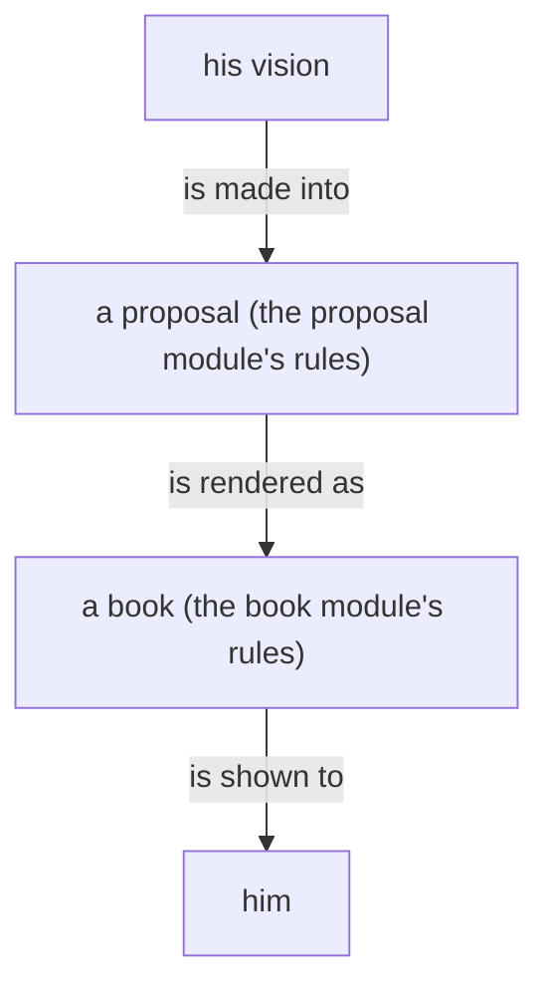

## A proposal

A proposal is the prose and the code that describe the system.

A proposal lives in its source file and is edited on his comments. A book is one publication of a proposal, at one link; the edited proposal is published as a new book, and the commented one stays as he left it.

A proposal states what is wanted of the system; it documents nothing. A proof, a test, a milestone or a sequence of work is an order, and goes to a bead; written into a proposal it is a vision impurity.

A versioned module is self-contained: everything true of that version is in it, and the version is named once, in its description. Another version is not mentioned.

A proposal is a proposal into belief modules, and the whole of it is its crystallization: what it removes and what it adds.

A proposal that touches a code component shows the code it changes or adds.

A code block in a proposal stands on its own: it is shown without a path, directory or file name. It carries the code, why it is important, and what its function is.

A proposal is usually drawn as well as written, and always when it has a shape: what it adds, removes and keeps, in one frame. A flowchart in a proposal is a proposed line like any other: it stands under the addition margin of the proposal it belongs to, which names the module it goes to.

The records a proposal draws from live in an unrendered reference file, one per book, in a references/ directory beside the books; they are archived with the landing when some or all of the proposal is accepted.

The proposal is the center of development: it is the evolution of an idea.

A line removed from a module is shown beside the line that makes it unnecessary.

A question between alternative lines shows each alternative as its own proposal, with the exact lines it lands; the living rules land, amend or reject.

Every word of his redoes the proposal it bears on, unless it closes the topic; words that open a topic of their own get a proposal of their own.

Every type a proposal names is in the proposal: added to the module it lands in, added to another module, or shown as it already stands in its vision module, its definition in full; naming a type is not showing it.

What can be expressed in code is shown as code, with a comment where the code needs one; prose is the comment on the code. A method is shown with the trait it belongs to and that trait's ethos, so its inputs and its yield are read. Code not yet settled is marked tentative. A "never" or an "always" is code: the rule is shown as the code that enforces it.

A shape is a flowchart, written in a mermaid fence and drawn by the bookmaker as a vector graphic. Prose carries only what neither code nor chart can. Ethos is the first chart: its types are the nodes and its traits the actions between them.

Code shown is complete: every name it uses is declared in the proposal, a method with its trait in ethos. A type wraps nothing without purpose: a variant carries a type bare when the wrapping would name nothing the type does not.

```ethos
Text.String                                   ; what herdr types; made from Waking, held by no struct
```

```rust
let text = Text(self.waking.datomize(Path::root()).protosize().textualize());   // only the waking becomes text
```



## A proposal is signed

A proposal is written by a Primary; a Secondary publishes it and lands it.

A proposal names the model that created it and, for each model that
helped, what that help was, on a subtitle line under the title. Created
by Fable, research by Opus, data retrieved by Sonnet.
