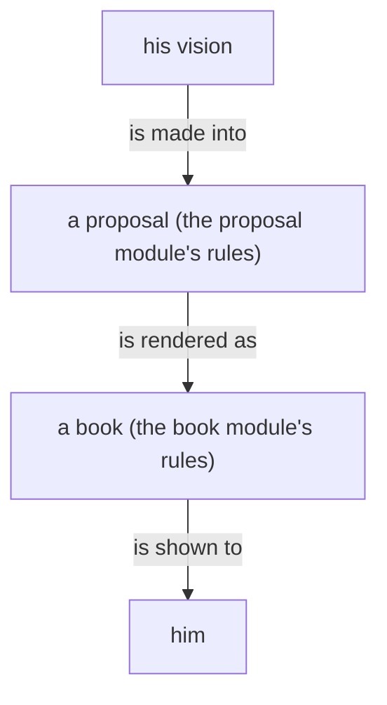

## A proposal

A proposal is the prose and the code that describe the system.

A proposal is a proposal into belief modules, and the whole of it is its crystallization: what it removes and what it adds.

A proposal that touches a code component shows the code it changes or adds.

A code block in a proposal stands on its own: it is shown without a path, directory or file name. It carries the code, why it is important, and what its function is.

A proposal is usually drawn as well as written, and always when it has a shape: what it adds, removes and keeps, in one frame.

The records a proposal draws from live in an unrendered reference file, one per book, in a references/ directory beside the books; they are archived with the landing when some or all of the proposal is accepted.

The proposal is the center of development: it is the evolution of an idea.

A line removed from a module is shown beside the line that makes it unnecessary; the compensation module is leaned out first, because vision replaces it.

A question between alternative lines shows each alternative as its own proposal, with the exact lines it lands; the living rules land, amend or reject.

Every word of his redoes the proposal it bears on, unless it closes the topic; words that open a topic of their own get a proposal of their own.

A proposal in the chat shows the whole section as it would stand, with the part that changes in bold.

## A proposal is signed

A proposal names the model that created it and, for each model that
helped, what that help was, on a subtitle line under the title. Created
by Fable, research by Opus, data retrieved by Sonnet.
