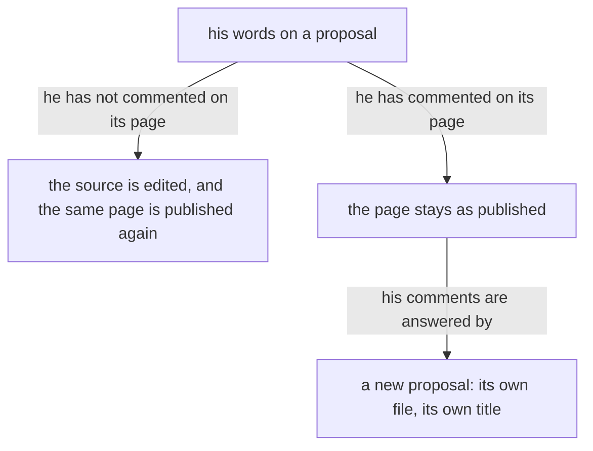
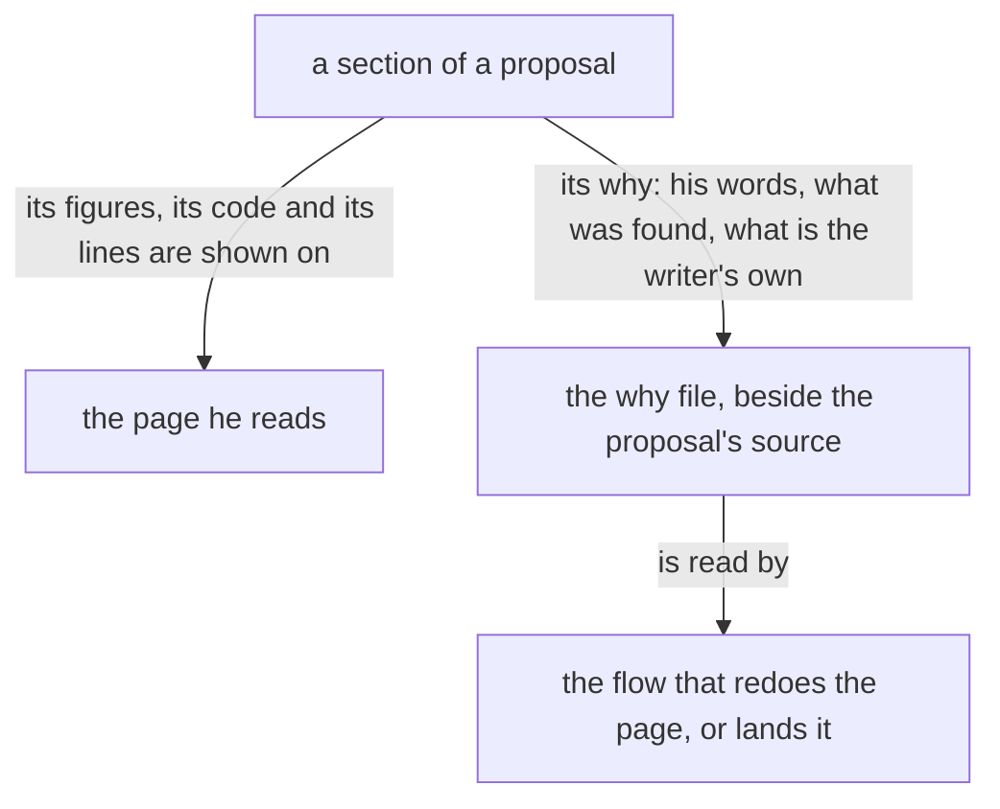
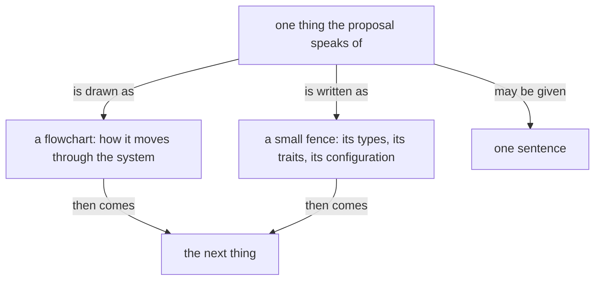
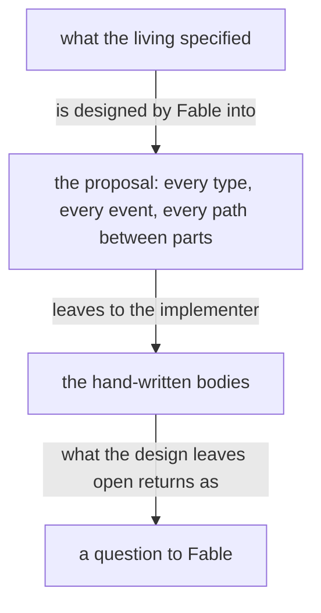
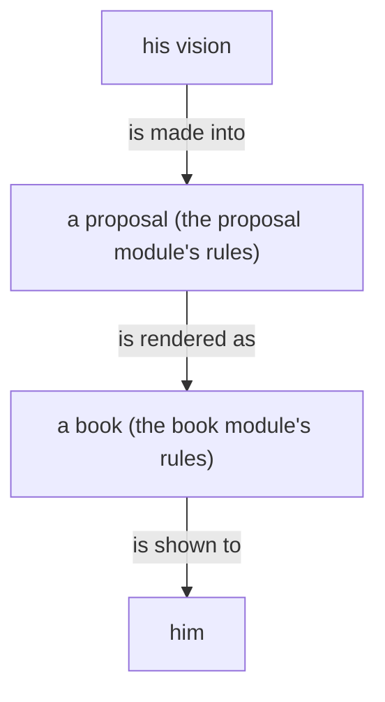
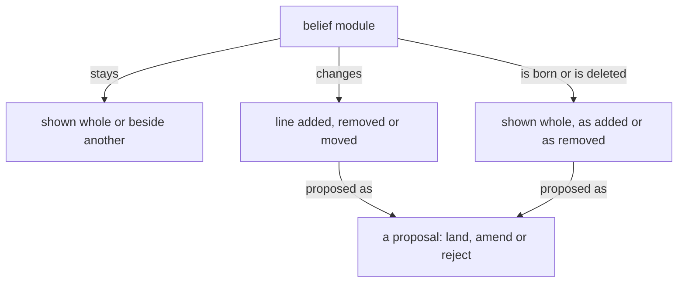

## A proposal

A proposal is a presentation: the flowcharts and the code that describe the system as it will be, shown as changes to belief modules, for the living to rule on.

A proposal lives in its source file. Until he has commented on its page, his words redo it there and the page is published again. Once he has commented on the page, it stays as published: his comments are answered by a new proposal, in a file and under a title of its own.



A proposal states what is wanted of the system; it documents nothing.

A proposal is the vision as it will be. A removed line is shown as the text it was, so the edit can be seen, and that is all that is made of it. A proof, a test, a milestone or a sequence of work is an order, and goes to a bead; written into a proposal it is a vision impurity.

A version is whole in the modules that hold for it: its own module and each span module that holds its number. A module names the versions it holds for once, in its name.

A proposal is a proposal into belief modules, and the whole of it is its purification: what it removes and what it adds.

A proposal has one subject, and small changes that belong together are one subject: one proposal per subject he would judge as one.

A section of a proposal is one thing he rules on, with one why. A change that only serves another is shown with it, in the same section.

A proposal into a module reconsiders the whole module: a new concept may change any part of what already stands there, and every such change is in the proposal. The modules that depend on it are reconsidered with it.

The why of an edit says why the edit is now necessary, in light of what the living said or what was found; it is what frees the proposal to change any line of the module. It is kept in a file beside the proposal's source, for the flows: for each section, his words the change stands on, what was found, and what is the writer's own without his word. The page he reads carries none of it.



The source of a proposal and its why file; the name is an example:

```text
proposals/effort-2.md
proposals/effort-2.why.md
```

A proposal goes one thing at a time. Each thing is shown as its flowchart and its code; one sentence stands beside them where they leave something unsaid.

Of each thing a proposal shows what it is, as its types; how it is configured, as datom; and how it moves through the system, as a flowchart.



Every thing a proposal speaks of is drawn. A figure draws what is wanted. A flowchart in a proposal is an added line like any other, of the proposal it belongs to, which names the module it goes to.

The proposal is the center of development: it is the evolution of an idea.

A line removed from a module is shown beside the line that makes it unnecessary.

A question between alternative lines shows each alternative as its own proposal, with the exact lines it lands; the living rules land, amend or reject.

Every word of his redoes the proposal it bears on, unless it closes the topic; words that open a topic of their own get a proposal of their own.

Every type a proposal names is in the proposal: added to the module it lands in, added to another module, or shown as it already stands in its vision module, its definition in full; naming a type is not showing it.

A fence holds one thing: the type, the trait, the configuration or the datom being spoken of. A proposal is many small fences, each standing where its thing is spoken of.

What can be expressed in code is shown as code. A method is shown with the trait it belongs to and that trait's ethos, so its inputs and its yield are read. Code not yet settled is marked tentative. A "never" or an "always" is code: the rule is shown as the code that enforces it.

A shape is a flowchart. Prose carries only what neither code nor chart can. Ethos is the first chart: its types are the nodes and its traits the actions between them.

Every name a fence uses is declared in the proposal, in that fence or in another; a method with its trait in ethos.

Everything the living specified is designed in the proposal down to its mechanics: each event, who announces it, what it carries and who acts on it, as flowcharts and code. The implementer is left the bodies.





## What a proposal shows

A module shown whole, as it stands, situates the landing.

A module shown beside another, both as they stand, serves comparison: psyche with knowledge.

A module shown or proposed shows its description, rendered as the description it is; a change to it shows as a line replaced does.

A new module shows whole, as added, under the path it will have.

A module deleted shows whole, as removed, with a Destroy or Archive mark.

A dependency changed shows in the module's front matter: the dependency removed and the dependency added.

A figure proposed for a module shows under that module's path, as an added line; a fence it replaces shows as removed lines.



## Who writes a proposal

A proposal into a psyche module, spirit, intent or vision, is written by Fable: the wanted lines and where they go, reading the belief modules itself. Opus writes one only when there is no Fable. A proposal into a knowledge module is written by Fable, Opus or Astra. The bookmaker publishes either; Opus lands it.
