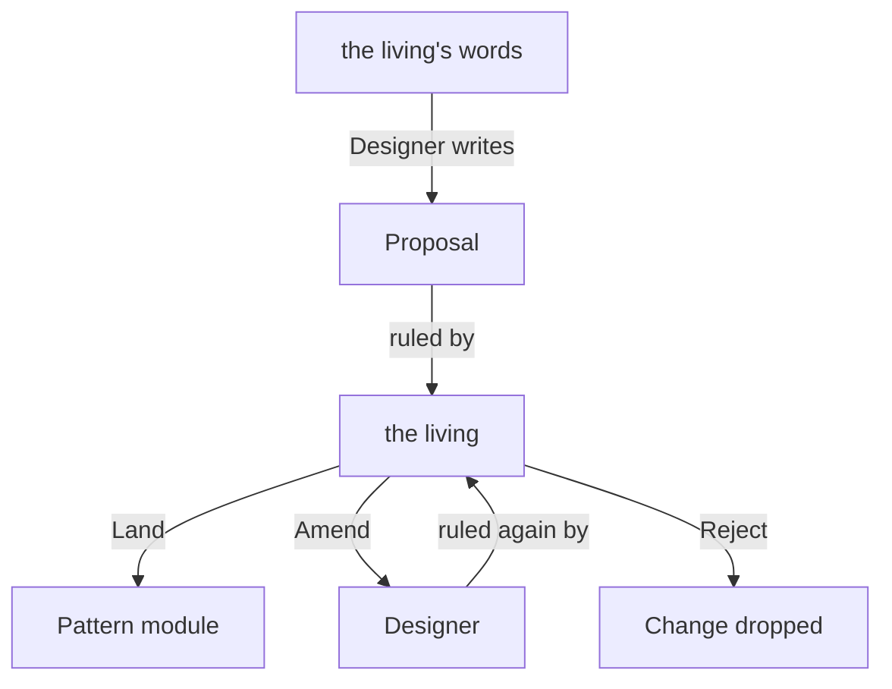

```ethos sketch
Types
[ ModulePath.String
  Lines.String
  Change.[ Added.Lines
           Removed.Lines
           Replaced.{ Lines Lines } ]
  Section.{ ModulePath
            Vector<Change> }
  Proposal.{ Title.String
             Vector<Section> }
  Ruling.[ Land
           Amend.String
           Reject ] ]
```

```datom
{ «Sanskrit, the Sema of the golden age»
  [ { «psyche-belief › vision/sanskrit/0.md»
      [ Added.«Sanskrit is the Sema of the golden age.» ] } ] }
```


