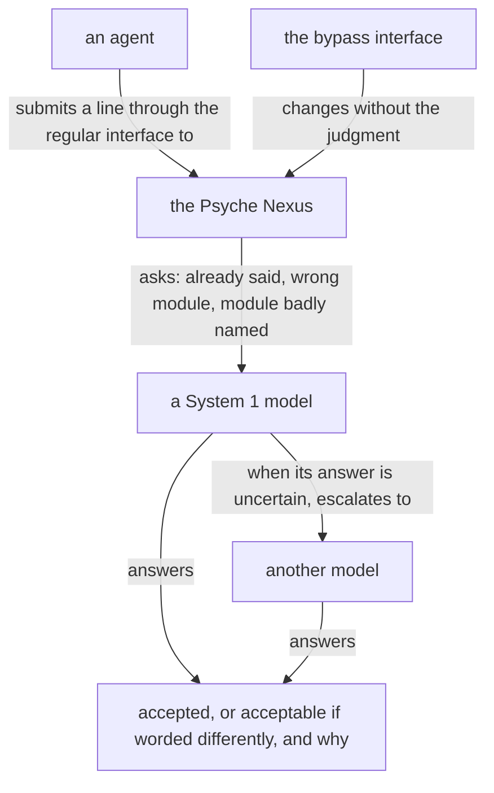

The Psyche Nexus holds the beliefs that belong to the psyche: spirit, intent and vision.

An agent that wants a line in the psyche submits it through the regular interface, and a judgment is run on the submission before anything changes. The judgment asks whether the line is already said somewhere in the psyche, the same or nearly; whether it is going into the wrong module; and whether the module it is going into is inadequately named.

The questions go to a System 1 model. Depending on the kind of submission, or on how certain the System 1 model's answer is, the judgment escalates to another model.

The answer is that the line is accepted, or that it is not, with what would make it acceptable: worded differently, and why.

A second interface bypasses the judgment.

The judgment is what lets the psyche be changed more quickly and safely.



The Signal of the submission, tentative in every name:

```ethos
Signal
[]
[ Submit.Submission ]
[ Accepted
  Refused.[ AlreadySaid.ModuleName
            WrongModule.ModuleName
            ModuleMisnamed.ModuleName
            Reword.Reason ] ]
[ ModuleName.String
  Line.String
  Reason.String
  Submission.{ ModuleName Line } ]
```

Submit offers one line to one module, and Accepted means the line is in. Refused is AlreadySaid, said already, the same or nearly, in that module; WrongModule, the line belongs in that module instead; ModuleMisnamed, the module it is going into is inadequately named; or Reword, acceptable if worded differently, and why. A ModuleName is a belief module by its name, a Line is the line submitted, and a Reason is what the judgment says of it.
