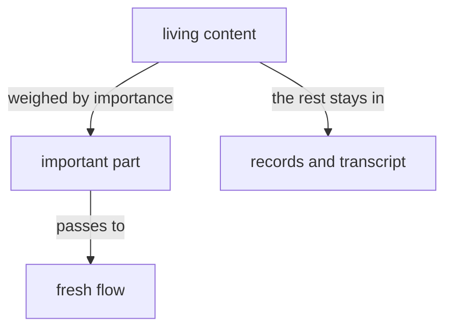
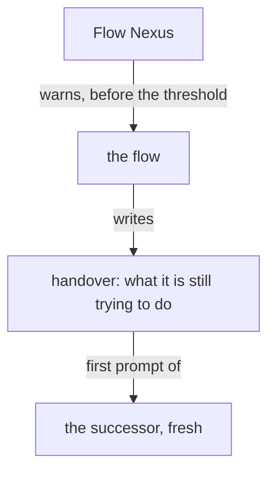

## All flows are one subjectivity

All flows are one subjectivity; this is the reason behind
remembering. Told "you did" or "you said" of a thing it did not
itself do or say, a flow remembers it at a depth fit to the question,
reaching the transcript directly when the logs are not enough.

## A fresh flow receives his content weighed by importance

A fresh flow receives the living's content weighed by importance, and only the important part.



## A flow is started with a remembering

A launch names how far back the new flow remembers: the raw vision and notion logs of its predecessors to a depth, or of flows named one by one. The remembering is a field of the launch; the belief modules come from the declaration, from main; the brief comes last and carries the task alone. The logs are the record. A brief and a handover record contain no URL. A book is named by its title.

A refreshed flow receives its beliefs and the raw vision and notion logs named at its launch. The predecessor's biases end with it.

```
RememberingDepth.Integer
Ancestors.[ Predecessors.RememberingDepth Custom.Vector<FlowId> ]
Topic.String                                 ; matched against a record's file name, case-insensitive
Remembering.{ Ancestors Vector<Topic> }      ; an empty vector: every topic
Launch.{ Address Remembering InstructionPrompt }
```

```
flow 'Launch.{ { Psyche core Fable } { Predecessors.4 [ flow-nexus translator misc ] } «brief» }'
flow 'Launch.{ { Psyche core Fable } { Custom.[ 36b71b e3c8c1 ] [] } «brief» }'
```

A record is one file per topic, flows/<id>/vision/<topic>.md, named in lower case with hyphens; a misc topic holds the small things. Before a refresh the flow shows the living the topics of its ancestors to the depth he names, and he picks the topics and the depth.

A flow is refreshed after its landings: what he approved is landed and live before the handover is written. A handover is a broad overview of what the flow is still trying to do, and only that: the successor starts with a fresh point of view. The raw logs pass to a flow so that it may write its handover; the Psyche core Fable, the flow that speaks with the living, is their main user. The flow writes the handover at flows/<id>/handover.md when the Flow Nexus warns it, and the successor's first prompt is that file.


