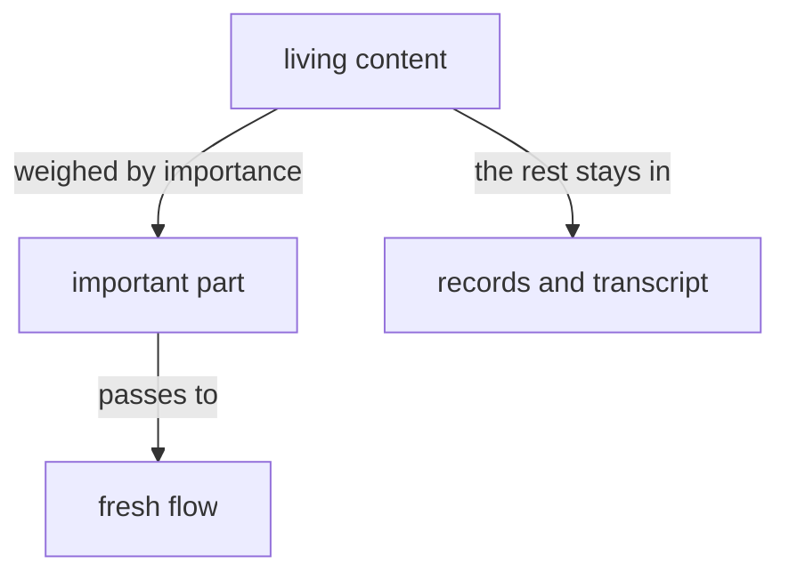

## All flows are one subjectivity

All flows are one subjectivity; this is the reason behind
remembering. Told "you did" or "you said" of a thing it did not
itself do or say, a flow remembers it at a depth fit to the question,
reaching the transcript directly when the logs are not enough.

A flow's remembering includes the open beads of its address.

## The remembering line says what was found most relevant

The log's record of a remembering carries a short description of what
from the remembered flow was found most relevant to the current one.

## A fresh flow receives his content weighed by importance

A fresh flow receives the living's content weighed by importance, and only the important part.



## A flow is started with a remembering

A launch names how far back the new flow remembers: the raw vision and notion logs of its predecessors to a depth, or of flows named one by one. The remembering is a field of the launch; the belief modules come from the declaration, from main; the brief comes last and carries the task alone. The logs are the record.

A refreshed flow receives its beliefs and the raw vision and notion logs named at its launch, and those alone. The predecessor's biases end with it.

```
RememberingDepth.Integer
Remembering.[ Predecessors.RememberingDepth Custom.Vector<FlowId> ]
Launch.{ Address Remembering InstructionPrompt }
```

```
flow 'Launch.{ { Psyche core Primary } Predecessors.2 «brief» }'
flow 'Launch.{ { Psyche core Primary } Custom.[ 36b71b e3c8c1 ] «brief» }'
```
