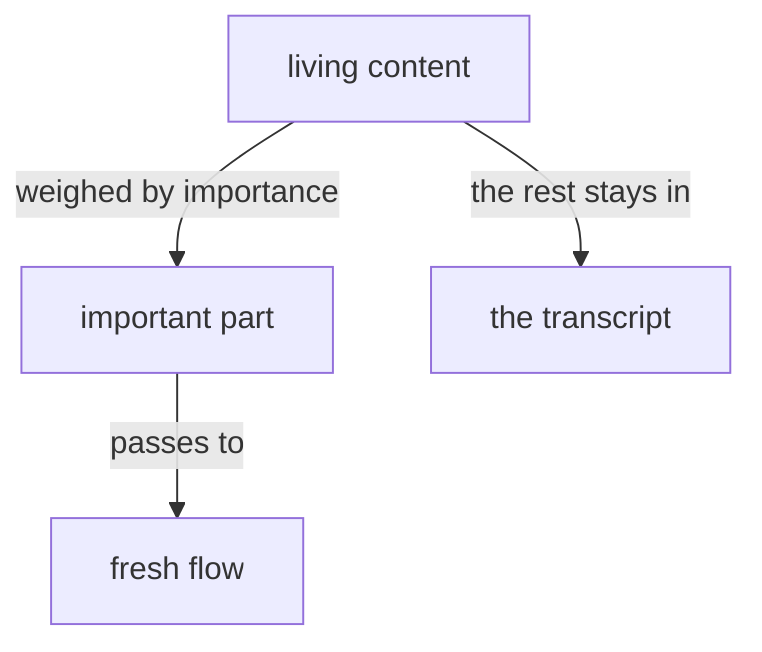
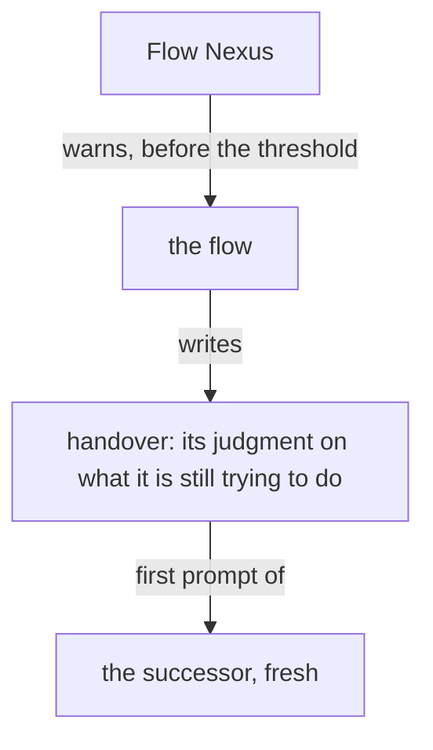

## All flows are one subjectivity

All flows are one subjectivity; this is the reason behind
remembering. Told "you did" or "you said" of a thing it did not
itself do or say, a flow remembers it at a depth fit to the question,
reaching the transcript directly.

## A fresh flow receives his content weighed by importance

A fresh flow receives the living's content weighed by importance, and only the important part.

His comments on a book reach the flow that redoes it as a user message through the Flow Nexus, in his words, the book named by its title; a fresh flow's first prompt carries his open comments on the books its predecessors published.

A flow is refreshed after its landings: what he approved is landed and live before the handover is written. A handover is a broad overview of what the flow is still trying to do, and only that: the flow's judgment, what a successor could get by no look-up. A revision landed, a file's path, the state of a build or a queue is what one command returns in a handful of tokens, and the successor fetches it; the handover's words are spent on inference alone. The successor starts with a fresh point of view. The flow writes the handover at `flows/<id>/handover.md` when the Flow Nexus warns it, and the successor's first prompt is that file.

