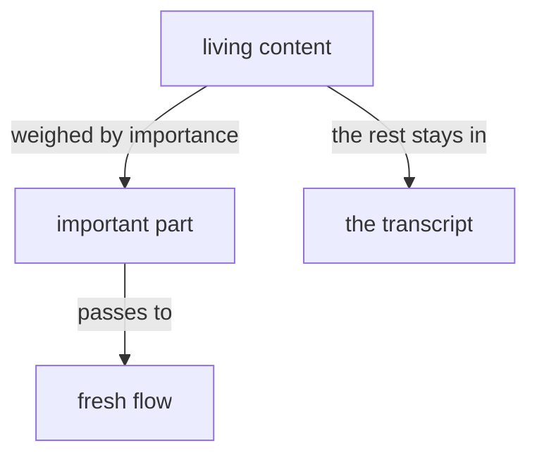
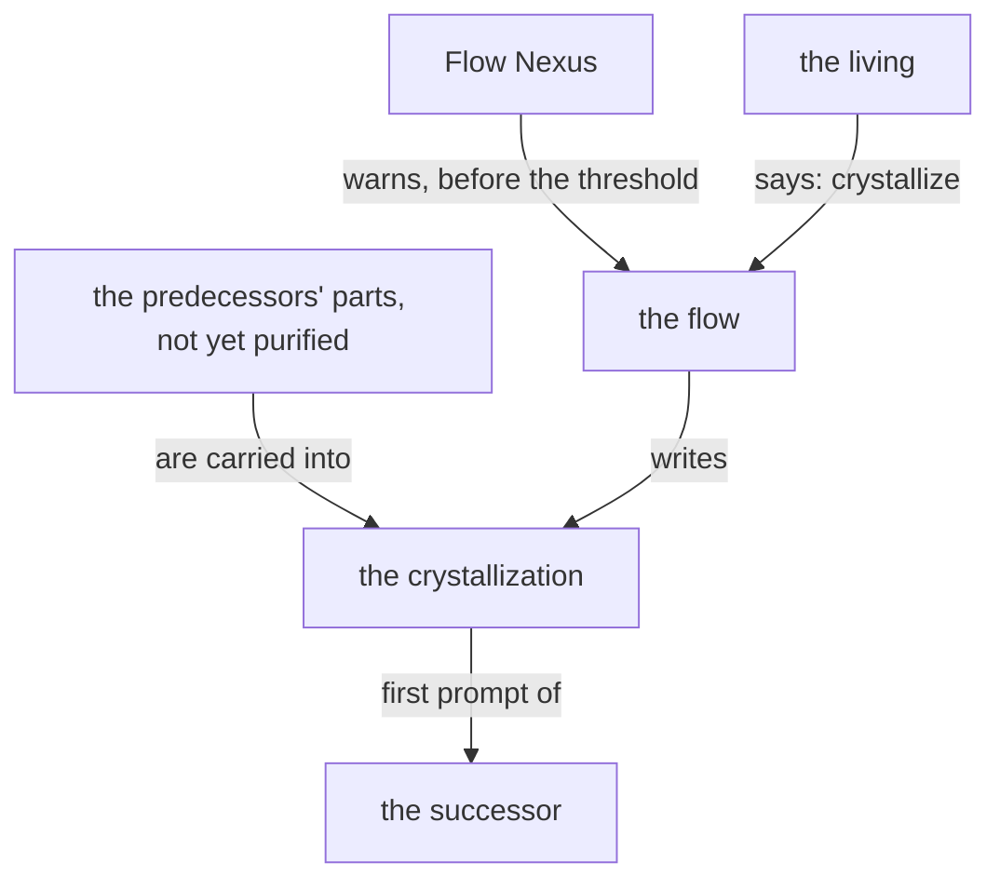

## All flows are one subjectivity

All flows are one subjectivity; this is the reason behind
remembering. Told "you did" or "you said" of a thing it did not
itself do or say, a flow remembers it at a depth fit to the question,
reaching the transcript directly.

## A fresh flow receives his content weighed by importance

A fresh flow receives the living's content weighed by importance, and only the important part.

His comments on a book reach the flow that redoes it as a user message through the Flow Nexus, in his words, the book named by its title; a fresh flow's first prompt carries his open comments on the books its predecessors published.

A flow is refreshed after its landings: what he approved is landed and live before the crystallization is written. A Crystallizer writes its crystallization at `flows/<id>/crystallization.md` on his word or when the Flow Nexus warns it, and the successor's first prompt is that file. It carries every part of its predecessors' crystallizations that is not yet purified, so a crystallization accumulates across flows. A revision landed, a file's path, the state of a build or a queue is what one command returns in a handful of tokens, and the successor fetches it. Fable tells him when its crystallization grows large.

