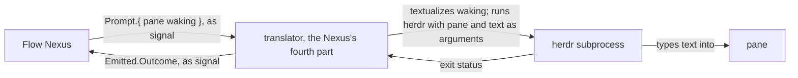
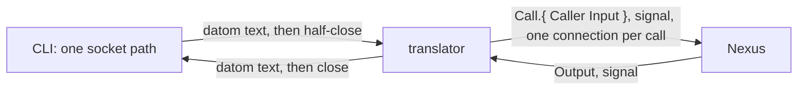

## The way out



What the Flow Nexus emits into the world, the fourth root. Every emission bears Emittable, implied, generated with the type and never written, as a Signal's inputs bear Answerable; the interaction is hand-written in the translator.

```ethos
Emission
[ flow:[ Pane Waking Keys Workspace Command ] ]           ; imports: defined below, in the Flow Nexus's library
[ Create.Workspace                                         ; emissions: make a pane in a workspace
  Start.{ Pane Command }                                   ;   start a harness in it
  Prompt.{ Pane Waking }                                   ;   type a waking into it
  Press.{ Pane Keys } ]                                    ;   press keys in it
[ Created.Pane                                             ; outcomes: the pane herdr made
  Started.Outcome
  Emitted.Outcome
  Pressed.Outcome ]
[ Outcome.[ Done                                           ; types: herdr did it, on the pane named
            Uncertain                                      ;   herdr answered, for a pane not the one named
            Refused.Refusal ]                              ;   herdr's exit status failed
  Refusal.{ Code.Integer Message.String } ]
```

What those inputs carry, in the Flow Nexus's library:

```ethos
Library
[ nexus:[ FlowId Address ] ]                               ; imports: vision:nexus
[ Session.String                                           ; types: the herdr session
  PaneId.String                                            ;   herdr's own name for a pane
  Pane.{ Session PaneId }                                  ;   what addresses one pane
  Root.String                                              ;   a directory
  Environment.Vector<{ Name.String Value.String }>
  Workspace.{ Session Root Environment }
  ModelName.String
  Effort.[ Low Medium High ]
  SystemPrompt.String
  Settings.String                                          ;   the harness's settings, as the harness reads them
  Command.{ ModelName Effort SystemPrompt Settings }       ;   everything a harness is started with
  Keys.Vector<String>
  Sender.[ Flow.{ Address FlowId } Living Nexus ]
  Request.[ Order.String Question.String Words.Vector<String> Result.String Notice.String ]
  Message.{ Priority Sender Request }                      ;   Priority: vision:messaging
  Waking.Vector<Message> ]                                 ;   one wake, oldest first
[]
[]
```

The translator's own library: the one value it holds.

```ethos
Library
[]
[ HerdrPath.String                                         ; the one path the translator holds
  Text.String                                              ; what herdr types; made from Waking, held by no struct
  Translator.{ HerdrPath } ]
[]
[]
```

The interaction, hand-written in the translator; the trait is generated with the root.

```rust
pub trait Emittable { type Outcome; fn emit(&self, translator: &Translator) -> Self::Outcome; }   // generated

impl Emittable for Prompt {
    type Outcome = Emitted;
    fn emit(&self, translator: &Translator) -> Emitted {
        // Only the waking becomes text. The pane goes into the arguments.
        let text = Text(self.waking.datomize(Path::root()).protosize().textualize());
        let output = Command::new(&translator.herdr_path.0)
            .args(["--session", &self.pane.session.0, "agent", "prompt", &self.pane.pane_id.0, &text.0])
            .output();
        let Ok(output) = output else { return Emitted(Outcome::Refused(Refusal::could_not_start())) };
        if !output.status.success() { return Emitted(Outcome::Refused(Refusal::from(&output))) }
        Emitted(match Reply::from(&output).names(&self.pane) { true => Outcome::Done, false => Outcome::Uncertain })
    }
}
```

In, as signal; then what herdr types into the pane:

```datom
Prompt.{ { main wQ:pT }
         [ { Soft Flow.{ { Psyche core Primary } 7 } Order.«Land the messaging line» } ] }
```

```datom
[ { Soft Flow.{ { Psyche core Primary } 7 } Order.«Land the messaging line» } ]
```

## The way in



```ethos
Library
[ signal_flow:[ Input Output Call Caller ] ]              ; imports
[ TranslatorSocket.String                                 ; types: the one path the CLI holds
  NexusSocket.String                                      ;   the one path the translator holds for its Nexus
  Outcome.[ Answered                                      ;   one reply written back, connection closed
            Unreadable.Error                              ;   the text did not actualize as Input; the error is the reply
            NexusDown ] ]
[ Serving.[ serve.{ [ Connection ] [ Outcome ] } ] ]      ; traits: one connection, one call, one reply
[ Translator.[ Serving ] ]
```

In the signal repository, the envelope every Nexus decodes:

```ethos
Caller.{ ProcessId.Integer UserId.Integer }               ; from the connection's peer credentials
Call.{ Caller Input }
```

```rust
impl Serving for Translator {
    fn serve(&self, mut caller: UnixStream) -> Outcome {
        let text = Text::read_to_end(&mut caller);                          // the CLI half-closed: EOF ends the request
        let input: Input = match Potential::<Input>::from(text).actualize(&mut self.budget()) {
            Ok(input) => input,
            Err(error) => { caller.write_all(error.datomize(Path::root()).protosize().textualize().as_bytes()); return Outcome::Unreadable(error) }
        };
        let who = Caller::from(caller.peer_cred());
        let Ok(mut nexus) = UnixStream::connect(&self.nexus_socket.0) else { return Outcome::NexusDown };
        nexus.write_all(&Call { caller: who, input }.archive());           // rkyv, length-prefixed
        let output: Output = Output::read(&mut nexus);                      // the one answer the Input names
        caller.write_all(output.datomize(Path::root()).protosize().textualize().as_bytes());
        Outcome::Answered                                                   // drop closes both
    }
}
```

The whole CLI:

```rust
fn main() {
    let mut translator = UnixStream::connect(TranslatorSocket::configured().0).unwrap();
    translator.write_all(std::env::args().nth(1).unwrap().as_bytes()).unwrap();
    translator.shutdown(Shutdown::Write).unwrap();
    std::io::copy(&mut translator, &mut std::io::stdout()).unwrap();
}
```
