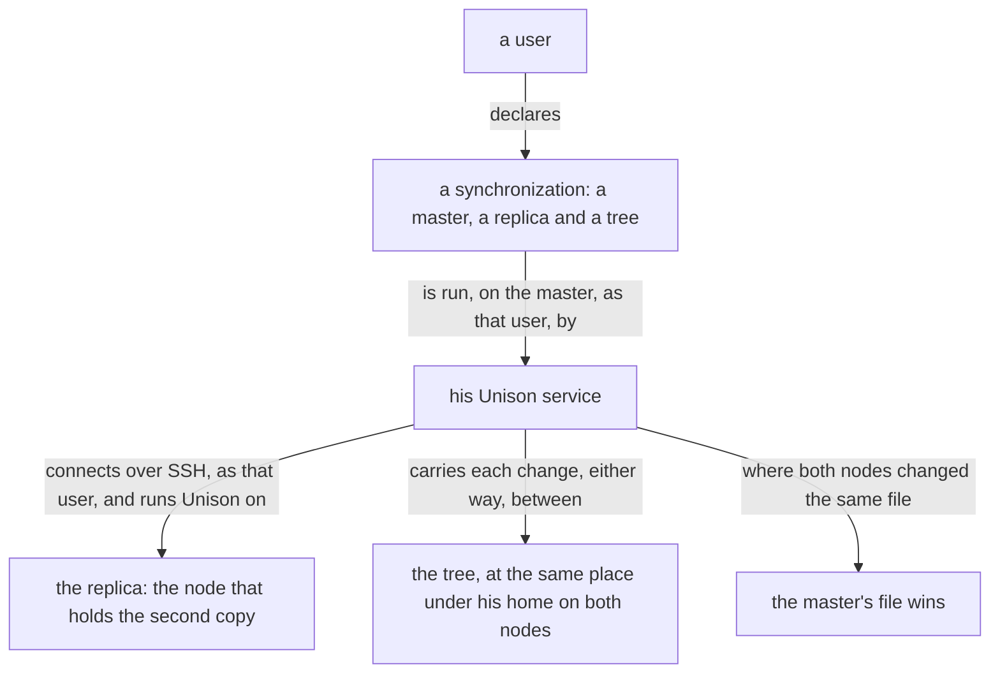
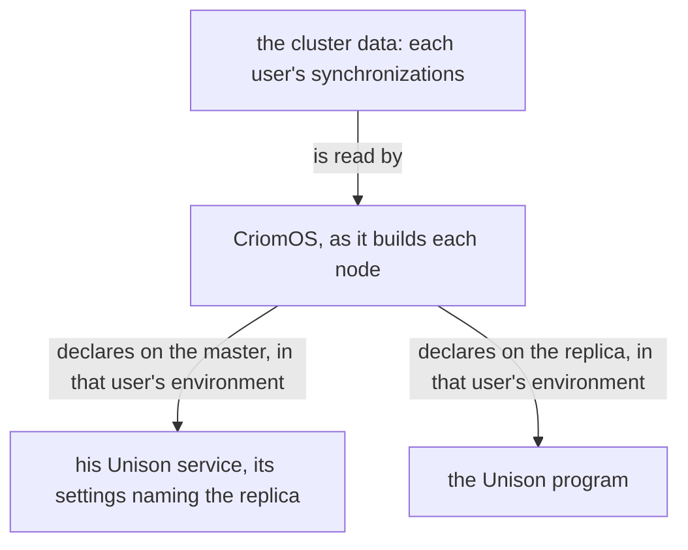
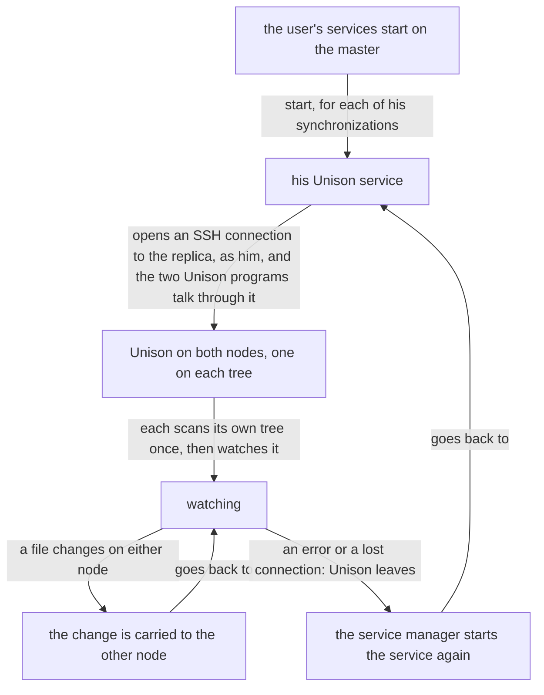

Unison makes two directories equal. Each node holds the tree as real files on its own disk, and reads and writes its own copy.

## A synchronization is a user's

A synchronization belongs to one user: it runs as him, over his SSH, on his files. Each user of a cluster declares his own, and several users synchronize on the same nodes, each his own trees.

```ethos sketch
Library
[ horizon:[ NodeName ] ]
[ Tree.String
  Synchronization.{ Master.NodeName
                    Replica.NodeName
                    Tree } ]
[]
[]
```

A Tree is a place under the user's home, the same on both nodes. A user's synchronizations in the cluster data:

```datom
[ Synchronization.{ laptop builder code } ]
```



## The service



What the service gives Unison; the paths and the host are an example:

```ini
root = /home/example/code
root = ssh://builder.example//home/example/code
repeat = watch
batch = true
prefer = /home/example/code
ignore = Name {target,result,.direnv}
```

A change on either node reaches the other. Where both changed the same file, the master's wins. A file takes its time from the node it arrives on. Version control is carried with the rest. What each node makes for itself stays where it is made: build outputs, the links Nix leaves, and the cache of a shell.

What is left out has a default and is configuration:

```nix
{
  criomos.unison.ignored = [ "target" "result" ".direnv" ];
}
```
