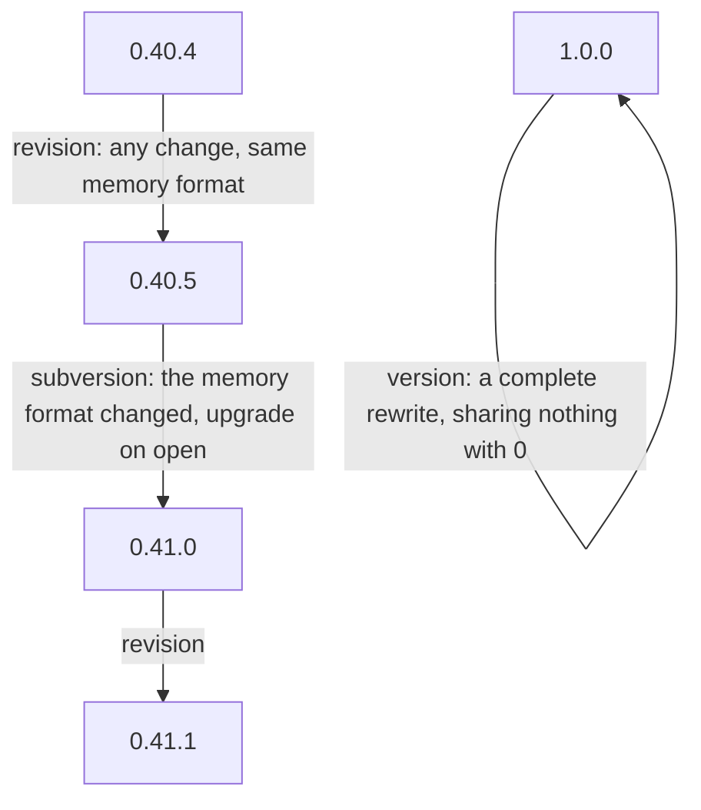

## The three numbers

A Nexus's version is three numbers. Any change that leaves the memory format alone is a new revision. A change of the memory format is a new subversion, and carries the upgrade from the previous format: the old store is upgraded to the new format on open, and a Nexus is never crippled to run on an old format; where a format cannot be upgraded in code, its data is migrated by interpretation. A complete rewrite is a new version. No build is ever the finished one: each takes the next number, and one or two revisions ship a day.

## A full rewrite

A full rewrite is the next version: built from the vision alone, reusing nothing of the implementation it replaces. It may live in the same repository, as a branch forked from the root commit and starting empty; this is one way of doing it, in Git or Jujutsu alike, and the rule is the empty start, not the tool. It runs beside the stable in a metaflow of its own and is switched to when it has proved itself.

## One source

Every part of a Nexus, its daemon and its clients, is built from one source at one version, so that none diverges.

## Stable and next

Every Nexus runs as a stable and a next, each declared in Nix and each on its own sockets; the stable is declared with the Nexuses it pairs with, as the fallback. A configuration names which of the two a new flow or a refresh starts on, and a running flow keeps running where it is. When every flow has moved onto next, next becomes stable and the newer version takes next. An upgrade is never all-or-nothing: the stable is there to fall back on, and a big change carries a countdown rollback that is cancelled once the new stack is seen working. Before the first deployment there is nothing to roll back to, and the system rolls forward.

## Metaflows

A metaflow is one whole running system: its Nexuses, their stores and their panes; it is what was called a capsule. A permaflow is one persistent address, { Aspect topic Layer }, with its succession of flows; it is what was called a metaflow. Several metaflows run side by side, each on its own sockets and store, and nothing in them depends on an environment variable: a flow is bound to its metaflow by configuration. A new version is tested in a metaflow of its own, with cheap flows messaging one another and starting flows, while the stable metaflow keeps running.

Metaflows talk to each other through an inter-metaflow interface, so that the flows of a new version speak with the permaflows of the metaflow being upgraded from. An upgrade then proceeds flow by flow, each new flow started in the new metaflow, and needs no store compatibility between the two.
