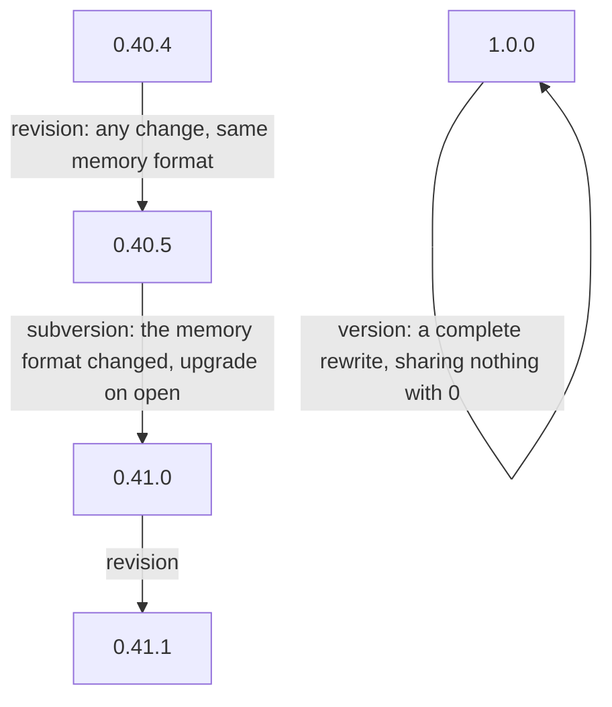
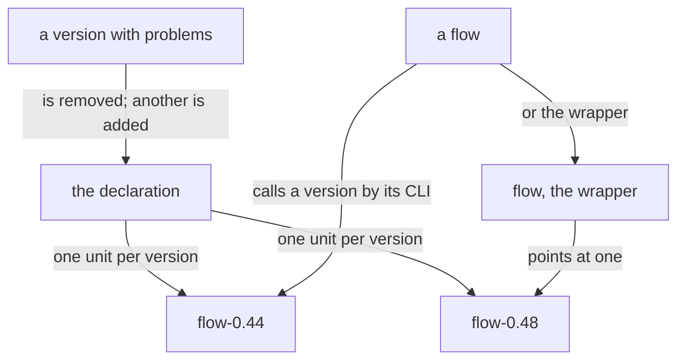

## The three numbers

A Nexus's version is three numbers. Any change that leaves the memory format alone is a new revision. A change of the memory format is a new subversion, and carries the upgrade from the previous format: the old store is upgraded to the new format on open, and a Nexus is never crippled to run on an old format; where a format cannot be upgraded in code, its data is migrated by interpretation. A complete rewrite is a new version. No build is ever the finished one: each takes the next number, and one or two revisions ship a day.



## A full rewrite

A full rewrite is the next version: built from the vision alone, reusing nothing of the implementation it replaces. It may live in the same repository, as a branch forked from the root commit and starting empty; this is one way of doing it, in Git or Jujutsu alike, and the rule is the empty start, not the tool. It runs beside the stable in a metaflow of its own and is switched to when it has proved itself.

While two versions live, each has its own vision module: the running version keeps vision:<nexus> and goes on taking fixes, and the rewrite is designed in vision:<nexus>-<version>, as vision:flow-nexus-v1; when the rewrite is the stable, the old module is archived and the new one takes the name.

## One source

Every part of a Nexus, its daemon and its clients, is built from one source at one version, so that none diverges.

## Versions side by side



Every version of a Nexus is its own declared unit, on its own sockets and store, and as many run at once as are wanted: two, three, five, since they are cheap to run. Each version has its raw CLI, named by the component and the version, `flow-0.44`; the bare name, `flow`, is a wrapper that points at one version. A flow calls a version by its CLI. Which flow runs on which version is state, moved by signal, outside the declaration. A version that proves to have problems is removed from the declaration and another added; the versions beside it keep running.

```sh
flow-0.48 'Send.{ … }'   # this version
flow 'Send.{ … }'        # the one the wrapper points at
```

## Places

A permaflow is one persistent address, { Aspect topic Model }, with its succession of flows. A complex is several metaflows defined together, the being one talks to; the Nexuses that run it are each started in a place, main or next, and nothing in them depends on an environment variable: a flow is bound to its Nexuses by configuration. A new version is tested at a place of its own, with cheap flows messaging one another and starting flows, while the stable place keeps running.

The Nexuses of two places talk to each other through an inter-place interface, so that the flows of a new version speak with the permaflows of the place being upgraded from. An upgrade then proceeds flow by flow, each new flow started at the new place, and needs no store compatibility between the two.

Side by side is the only upgrade between places: a new place is told its complexes by replaying the owner's definition files, and nothing is migrated from the place before it. Within a place, a subversion upgrades the store on open.
