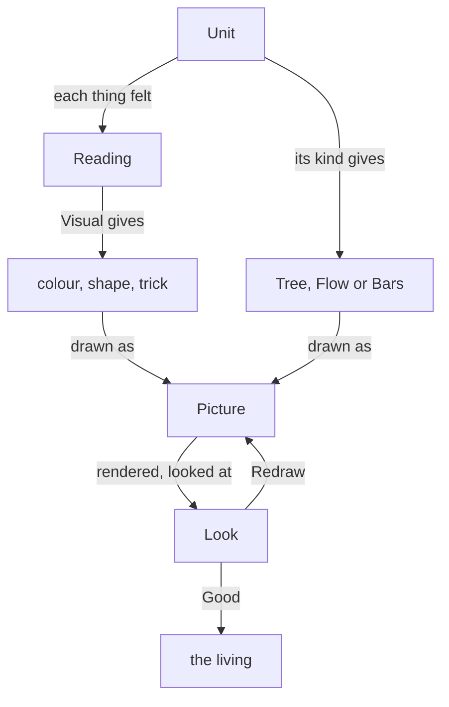

Visualization: a unit of a source, read by its qualities and drawn as one picture the living takes in at a glance; rests on vision:planetary-visuals:0.

```ethos sketch
Types
[ Unit.[ Ethos Datom Chart Quantity ]
  Picture.[ Tree Flow Bars ]
  Reading.{ Thing.String
            Body.Quality
            Edge.Option<Quality> }
  Look.[ Good
         Redraw.String ] ]
```



```datom
[ { Ethos Tree }
  { Datom Tree }
  { Chart Flow }
  { Quantity Bars } ]
```

```datom
{ datom Mercurial Some.Saturnian }
```

```datom
[ { Statement «one to three, in the picture, the largest words» }
  { Feeling «a thing is of the quality it feels like; the drawer chooses among that quality's colours, shapes and tricks» }
  { Same «a thing keeps its colour and its form in every picture» }
  { Itself «a thing is drawn as the thing: a file as a file» }
  { Words «names and values; an arrow carries three words at most» }
  { Phone «every name is read on a phone» }
  { One «one idea; a crowded picture is two pictures» } ]
```

```datom
[ { Question «the headline: what the picture answers» }
  { Track «the limit; every bar on one scale» }
  { Fill «what is used, its number at its end» }
  { Tick «what was expected by now» }
  { Gap «between the fill and the tick: ahead in one colour, behind in another» } ]
```
